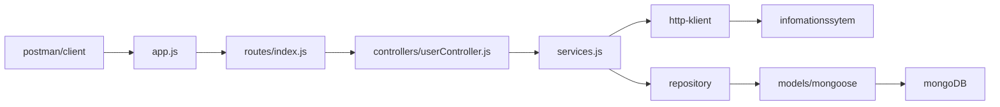

# arkitektur før kode 

# Projektbeskrivelse

# Startvejledning

# Arbejdspørgmål

#### Hvorfor er én stor server.js med endpoints, databasekald og regler en dårlig idé?

det går i mod clean arkitekture  hvilket gør det svært at vedligeholde og teste koden. Det kan også føre til duplikering af kode og gøre det sværere at genbruge komponenter.

#### Hvad er forskellen på en controller og en service?

en controller håndterer HTTP-forespørgsler og svar, mens en service indeholder forretningslogik og interagerer med databasen eller andre eksterne systemer. Controlleren fungerer som et mellemled mellem klienten og servicen.

#### Hvilket lag skal kontrollere, om Orion allerede er tildelt?

Det skal ske i service-laget, da dette er stedet hvor forretningslogikken ligger.

#### Hvor placerer I MongoDB-forespørgsler – og hvorfor?
i repositories 

#### Hvordan kan I teste forretningslogik uden at starte HTTP-serveren? unit tests 

